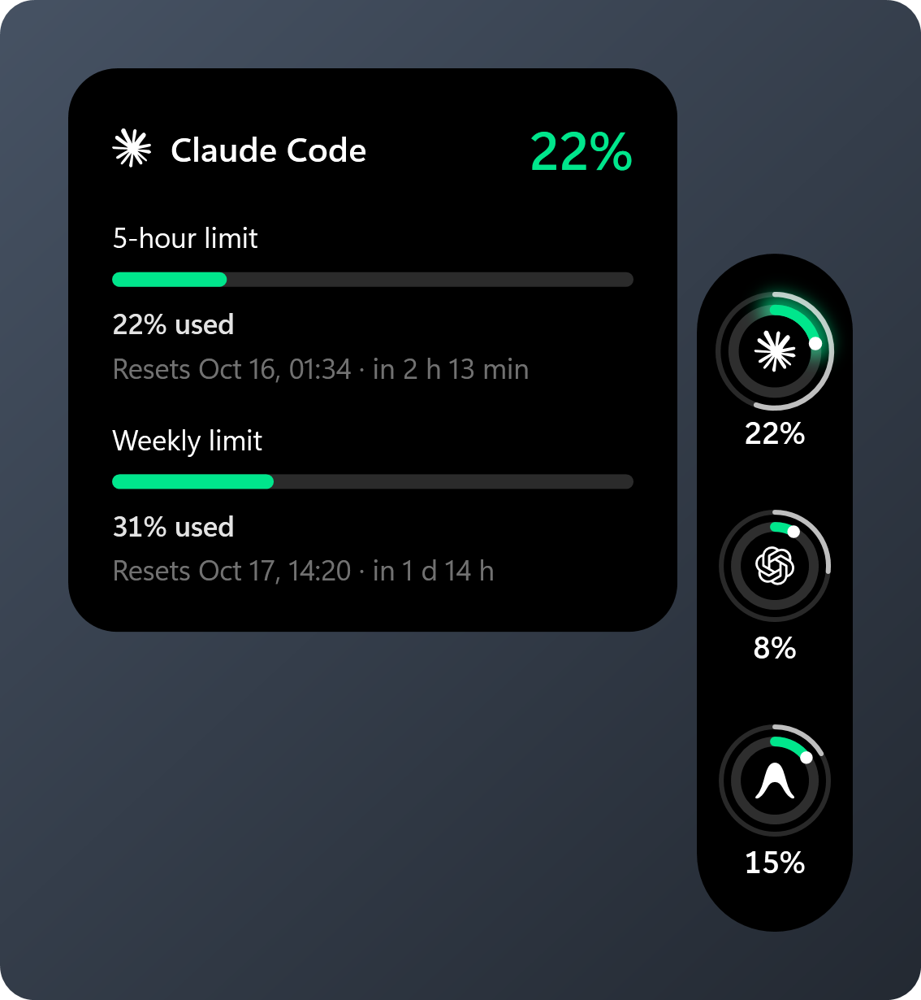

# OrbMet

A small Windows panel that shows how much of your **Claude Code** and **Codex**
usage limits you have used, so you can see it at a glance while you work in
the terminal.

<p align="center"></p>

OrbMet sits on the edge of your screen as a black strip with one ring per
provider. The ring fills as you use your limit and changes colour only when it
starts to matter: green below 50%, yellow below 75%, red above.

## Features

- One ring per provider showing its 5-hour limit, as the provider reports it.
  The menu can switch the rings to the weekly limit, or to whichever limit is
  closest to running out.
- Hover a ring to see every limit it reports (5-hour, weekly, per model),
  how much of each is used and when it resets.
- Click a ring to refresh it.
- The tray icon is a small copy of the fullest ring; hover it for every
  provider's figure.
- Optional notifications (off until you pick a threshold in the menu): when a
  limit passes 75, 80, 90 or 95%, when it runs out, when a limit you were
  warned about resets, and when Claude Code gets disconnected or Codex can't
  be read. Each is said once.
- Drag the strip to any edge or corner and it docks there, or leave it
  anywhere on screen. It remembers where.
- Never takes focus from your terminal.
- Can start with Windows (off unless you turn it on in the menu).
- Tells you when a new version is out. If you used the installer, **Update**
  in the menu downloads it, installs it and restarts OrbMet; from the zip it
  opens the download page.
- English and Turkish, switchable from the menu.

<p align="center"></p>

## Requirements

- Windows 10 or 11, x64
- [Claude Code](https://docs.claude.com/en/docs/claude-code), [Codex CLI](https://github.com/openai/codex), or both

## Install

Download from [Releases](../../releases). Neither needs .NET installed.

| Download | What it is |
| --- | --- |
| `OrbMet-<version>-setup.exe` | Installer. Installs for your user only (no administrator rights), adds a Start menu shortcut and an entry in **Installed apps**, and can start OrbMet with Windows. |
| `OrbMet-<version>-win-x64.zip` | The same app without an installer: unpack it into a folder you will keep and run `OrbMet.exe`. |

OrbMet is not code-signed, so the first time you run it Windows may show
**Windows protected your PC**. Click **More info**, then **Run anyway**.

OrbMet lives in the system tray. Right-click the strip or the tray icon for
the menu; **Exit** is in the tray menu.

## Connecting

### Codex

Nothing to set up. OrbMet finds `codex` on your `PATH` and asks it for your
rate limits through `codex app-server`, using the sign-in you already have.
It checks every two minutes and when you click the ring.

### Claude Code

Claude Code reports usage to its status line, so OrbMet needs to be connected
once: right-click the strip, open **Connections** and press **Connect**.

This changes one setting, `statusLine` in `~/.claude/settings.json`, so that
Claude Code runs OrbMet's small helper (`OrbMet.Capture.exe`) after each
response. Good to know:

- If you already had a status line, it keeps showing: the helper runs your
  command and prints its output.
- Your original settings file is backed up once to
  `%LOCALAPPDATA%\OrbMet\backups` before the first change.
- **Disconnect** puts your previous status line back exactly as it was.
- Usage updates when Claude Code finishes a response. OrbMet never sends
  prompts to make data appear.
- If you move the OrbMet folder, the Connections window says so and offers
  **Reconnect**.

## Privacy

OrbMet sends nothing about you or your usage anywhere. Its one network
request of its own is the update check:

- At start and once a day it asks GitHub for OrbMet's latest release
  (`api.github.com/repos/29ardayildiz/OrbMet/releases/latest`). GitHub sees
  your IP address, as with any download; no account, usage or settings are
  sent. Turn it off with **Check for updates** in the menu.
- Updating downloads the installer from this repository's releases and
  checks its SHA-256 before running it.

- After each response, Claude Code hands the helper a summary of the session.
  The helper keeps only the rate-limit figures (percentages and reset times)
  and a one-way hash of the session id, in `%LOCALAPPDATA%\OrbMet`, and
  discards the rest.
- Codex usage comes from `codex app-server` and is kept in memory.
- Prompts, transcripts and credentials are never read or stored.

## How the numbers are shown

- Percentages are exactly what the provider reports; OrbMet does not estimate
  usage from tokens or cost.
- Missing data shows as `—`, never as 0%.
- When a limit's reset time passes, its old value is hidden until new data
  arrives, rather than shown as the new period's.
- Data that is not fresh carries its age, such as "As of 12 min ago".

## Uninstall

**Installed:** uninstall OrbMet from **Settings > Apps > Installed apps**. It
puts Claude Code's previous status line back, removes the Start with Windows
entry, and asks whether to delete your settings in `%LOCALAPPDATA%\OrbMet`.

**From the zip:** press **Disconnect** in Connections if Claude Code is
connected, turn off **Start with Windows** if it is on, exit OrbMet from the
tray, then delete its folder and `%LOCALAPPDATA%\OrbMet`.

## Building

Requires the [.NET 10 SDK](https://dotnet.microsoft.com/download/dotnet/10.0).

```powershell
dotnet build -c Debug
dotnet test -c Debug --no-build
```

Release packages:

```powershell
powershell -ExecutionPolicy Bypass -File tools\publish.ps1 -Version 0.2.0
```

This writes the installer and the zip to `artifacts\`. The installer needs
[Inno Setup 6](https://jrsoftware.org/isinfo.php)
(`winget install JRSoftware.InnoSetup`).

## Credits

Provider marks come from [Lobe Icons](https://github.com/lobehub/lobe-icons)
(MIT). Third-party licences are listed in
[THIRD_PARTY_NOTICES.md](THIRD_PARTY_NOTICES.md).

Claude and OpenAI names and marks belong to their owners. OrbMet is not
affiliated with or endorsed by Anthropic or OpenAI.

## License

[MIT](LICENSE)
